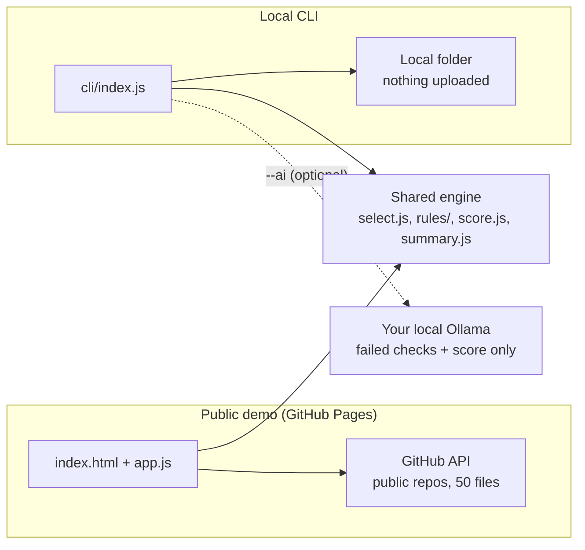

# DevOps Repo Checker

A free tool that scores the DevOps quality of a repository. It reads the files, runs deterministic rules (Docker, Kubernetes, CI/CD, Terraform/AWS, secrets, docs) and shows a score out of 100, a per-category breakdown, a prioritized list ("fix first / worth fixing / lower priority") and an example fix for every problem. Hebrew (RTL) and English.

No server, no accounts, no API keys, no runtime dependencies. The same rule engine runs in the browser and on the command line.

<!-- TODO: add a screenshot, e.g. docs/screenshot.png -->
> Screenshot placeholder

**Try it:** `<web demo link, after enabling GitHub Pages>`

## Architecture



## Two ways to run it

| | Public demo | Local CLI |
|---|---|---|
| Runs | in your browser, static files | `node cli/index.js <folder>` |
| Input | a public GitHub repo URL | any local folder |
| Limits | public repos, up to 50 files, 100 KB per file, GitHub API rate limit | none (reads the whole folder) |
| AI | none | optional, your own local Ollama |

### Web demo

Open the demo link above, or serve `public/` yourself:

```bash
npm run dev    # python3 -m http.server 8000 --directory public
```

### Local CLI (Node 18 or newer, nothing to install)

```bash
git clone <this repo>
cd devops-repo-checker
node cli/index.js .
```

```
node cli/index.js <folder> [--lang en|he] [--json] [--fixes] [--include-examples] [--fail-under N] [--ai [--model NAME]]
```

- `--lang en|he`: report language (default `en`; Hebrew shows reversed in many terminals)
- `--json`: machine-readable result (no file contents)
- `--fixes`: print an example fix under each problem
- `--include-examples`: also check `tests/`, `examples/` and intentionally broken files
- `--fail-under N`: exit with code 1 if the score is below N (use it as a CI gate)

The project checks itself in CI: `node cli/index.js . --fail-under 70`.

### Optional AI summary with Ollama (`--ai`)

The AI is never required. With [Ollama](https://ollama.com) running on your machine:

```bash
ollama pull llama3.2
node cli/index.js . --ai                  # uses the first installed model
node cli/index.js . --ai --model llama3.2
```

Only the failed checks (their English text, severity, number of files) and the score are sent, to `http://localhost:11434` or `OLLAMA_HOST`. File names and file contents are never sent. If Ollama is not running, you get one line explaining it and the normal report continues.

## Rules (27)

Score: severity weights high 3, medium 2, low 1; category weights security 30, containers 20, CI/CD 20, IaC 20, Kubernetes 20, docs 10. Categories without files are not penalized.

| Rule | Category | Severity | Checks that... |
|---|---|---|---|
| `docker-user-root` | containers | high | the container does not run as root |
| `docker-latest` | containers | med | the base image has a fixed version |
| `docker-healthcheck` | containers | low | a HEALTHCHECK exists |
| `k8s-memory-limit` | kubernetes | med | containers have memory limits |
| `k8s-requests` | kubernetes | low | resource requests exist |
| `k8s-readiness` | kubernetes | med | a readinessProbe exists |
| `k8s-nonroot` | kubernetes | med | containers run as non-root |
| `k8s-privileged` | kubernetes | high | no privileged / host access |
| `k8s-latest` | kubernetes | med | images have a fixed version |
| `k8s-secret-ref` | kubernetes | low | referenced Secrets are defined |
| `k8s-service-selector` | kubernetes | med | Service selectors match Pod labels |
| `ci-exists` | cicd | med | a CI/CD pipeline exists |
| `ci-tests` | cicd | med | the pipeline runs tests or validation |
| `ci-pinned-actions` | cicd | med | Actions are pinned to a version |
| `ci-permissions` | cicd | low | the workflow defines permissions |
| `ci-security` | cicd | med | a security or dependency scan exists |
| `tests-exist` | cicd | med | automated tests exist |
| `tf-open-ingress` | iac | high | no security group open to 0.0.0.0/0 |
| `tf-public-s3` | iac | high | S3 buckets are not public |
| `tf-iam-wildcard` | iac | high | no IAM `Action: *` |
| `tf-remote-state` | iac | low | Terraform uses a remote backend |
| `tf-eks-public` | iac | med | the EKS endpoint is restricted |
| `secrets-in-code` | security | high | no secrets in code (value never shown) |
| `committed-secret-files` | security | high | no `.env`, keys or `tfstate` committed |
| `docs-readme` | docs | low | a README exists |
| `docs-license` | docs | low | a LICENSE exists |
| `docs-gitignore` | docs | low | a .gitignore exists |

## Limitations

- The web demo reads public repositories only, up to 50 files and 100 KB per file.
- Terraform analysis is text based (no HCL parser).
- Helm templates are skipped.
- Files in `tests/`, `examples/`, `fixtures/`, `demo/`, `scenarios/`, folders with both a "problem" and a "fix" file, and files marked `# devops-checker: ignore` are skipped, because they are usually broken on purpose. Use "Check them too" or `--include-examples`.
- Results are a lightweight aid, not a security audit.

## Disclaimer

This tool is provided "as is" for informational and educational purposes only. It is an aid, not professional advice or a security audit. Scores and suggestions may be incomplete or inaccurate. You are solely responsible for how you use the tool and for any change you make to your project. The author accepts no liability for any damage or loss.

## Adding a rule

1. Write a function in `public/rules/*.js` that returns `{ id, category, severity, pass, file, detail }` per file (see `hygiene.js` for the smallest example) and add it to that file's exported list.
2. Add its texts (`fail`, `pass`, `why`) in Hebrew and English to `public/i18n/strings.js`.
3. Add an example fix to `public/rules/fixes.js`.
4. If the category is new, add a weight in `public/score.js` and a name in `strings.js` (`categories`).
5. Add a test in `tests/` and run `npm test`.

## License

MIT, see [LICENSE](LICENSE).
