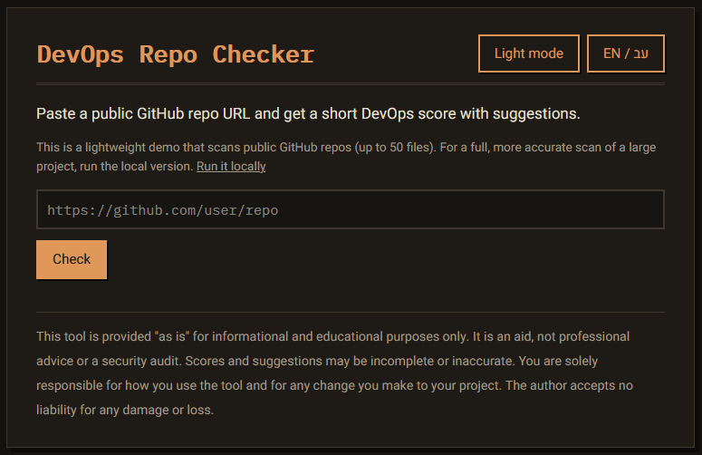
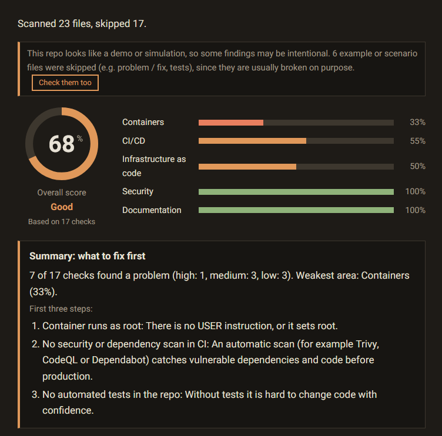
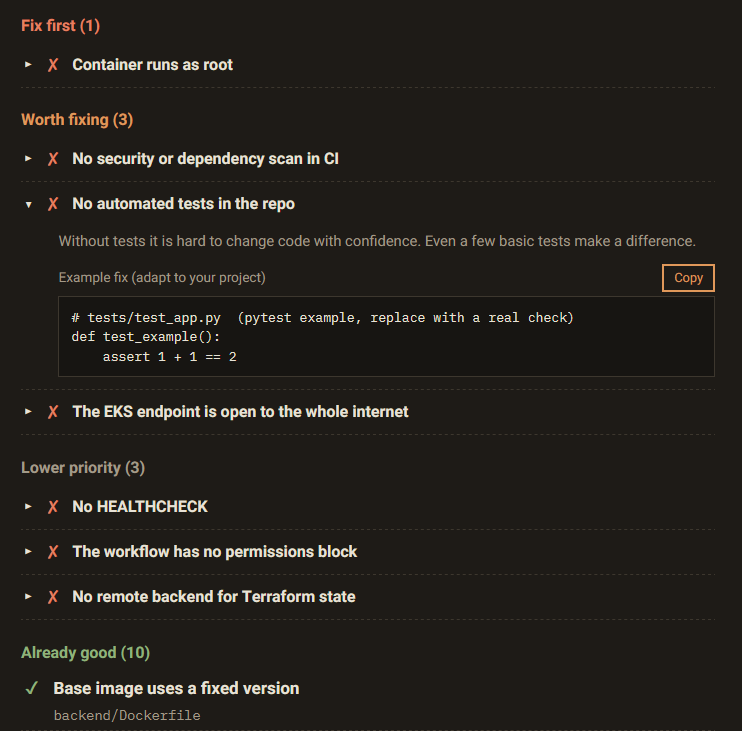
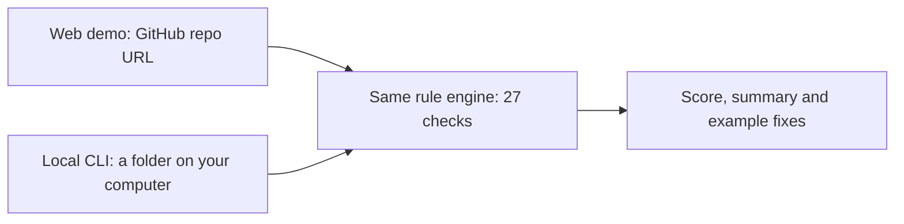

# DevOps Repo Checker


Checks the DevOps quality of a repository and gives it a score out of 100, with a prioritized list of problems and an example fix for each one. It covers Docker, Kubernetes, CI/CD, Terraform/AWS, secrets and documentation. Hebrew and English.



## Try it

**Web demo:** https://kinanw38.github.io/devops-repo-checker/

Paste the URL of a public GitHub repository and get the result in a few seconds. Nothing to install.

## What you get

| What to fix first | An example fix for every problem |
|---|---|
|  |  |

## Two ways to use it

| | Web demo | Local CLI |
|---|---|---|
| What it is | a web page, open it and try | a command you run on your own computer |
| Scans | a public GitHub repo (by URL) | any folder on your machine, private projects too |
| Size | light: up to 50 files | the whole project, no file limit |
| Best for | trying it quickly | an accurate scan, and CI |

Both use exactly the same rules. Nothing you scan is uploaded anywhere: the web demo runs in your browser, the CLI runs on your computer.

## Run it locally

You need [Node.js](https://nodejs.org) 18 or newer. There is nothing else to install.

```bash
git clone https://github.com/Kinanw38/devops-repo-checker.git
cd devops-repo-checker
node cli/index.js /path/to/your/project
```

Use `.` to scan the current folder (for example `node cli/index.js .` scans this repository itself).

### Options

| Option | What it does |
|---|---|
| `--lang he` | print the report in Hebrew (default: English). Many terminals show Hebrew reversed |
| `--fixes` | also print an example fix for every problem |
| `--json` | print the result as JSON, for scripts |
| `--fail-under 70` | exit with an error if the score is below 70 (useful in CI) |
| `--include-examples` | also check example, test and scenario files (skipped by default) |
| `--ai` | add a short AI summary using your own local Ollama (optional, see below) |

### Optional: AI summary with Ollama

The AI is optional and runs only on your machine, with no account or API key.

```bash
ollama pull <a-model-you-like>
node cli/index.js . --ai --model <a-model-you-like>
```

Only the names of the failed checks and the score are sent to Ollama, never your code or file names. Ollama is expected at `http://localhost:11434` (set `OLLAMA_HOST` to change it). If it is not running, the normal report is printed anyway.

## How it works



## What it checks (27 rules)

| Area | Checks |
|---|---|
| Containers | runs as root, base image version, HEALTHCHECK |
| Kubernetes | memory limit, resource requests, readinessProbe, non-root, privileged, image version, missing Secret, Service selector that matches no pod |
| CI/CD | a pipeline exists, runs tests, actions pinned to a version, workflow permissions, security or dependency scan, automated tests exist |
| Terraform / AWS | security group open to the internet, public S3, IAM `Action: *`, remote state, public EKS endpoint |
| Security | secrets in code (the value is never shown), committed `.env`, keys and state files |
| Docs | README, LICENSE, .gitignore |

Example, test and "problem / fix" scenario files are skipped, because they are usually broken on purpose. To skip a file yourself, put `# devops-checker: ignore` at its top.

## Limits

- The web demo works only with public repositories, up to 50 files of up to 100 KB each, and GitHub limits how many requests an unauthenticated visitor can make per hour. For a large project use the local CLI.
- Terraform is analyzed as text (there is no HCL parser). Helm templates are skipped.
- The checks are a guide, not a full audit.

## Disclaimer

This tool is provided "as is" for informational and educational purposes only. It is an aid, not professional advice or a security audit. Scores and suggestions may be incomplete or inaccurate. You are solely responsible for how you use the tool and for any change you make to your project. The author accepts no liability for any damage or loss.

## Run the web page on your computer (for development)

```bash
npm run dev
```

Then open http://localhost:8000. This starts a tiny local web server (Python's built-in one) that serves the `public/` folder, so you can try changes to the page before publishing. It needs Python 3 and is only for people who want to modify the web demo. To simply use the tool, open the demo link above or use the CLI.

## Add a rule

1. Write the check as a function in `public/rules/` (see the existing files for the shape: it returns `{ id, category, severity, pass, file }`), and add it to the list in `public/rules/engine.js`.
2. Add its texts (fail, pass, why) in Hebrew and English in `public/i18n/strings.js`.
3. Add an example fix in `public/rules/fixes.js`.
4. Add a test in `tests/` and run `npm test`.

## Tests and CI

`npm test` runs the automated tests. On every push to `main`, GitHub Actions runs the tests, runs this tool on its own code, and publishes the web demo to GitHub Pages.

## License

MIT, see [LICENSE](LICENSE).